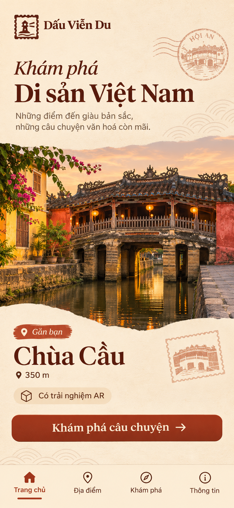
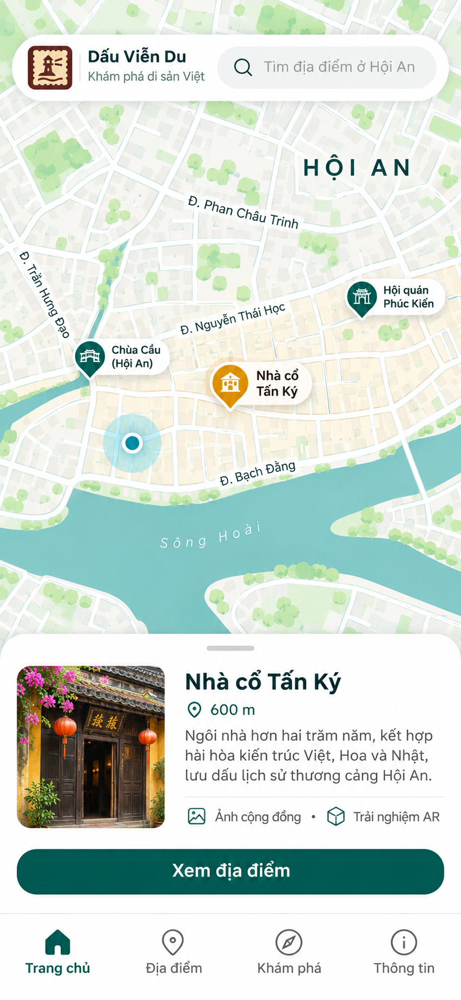
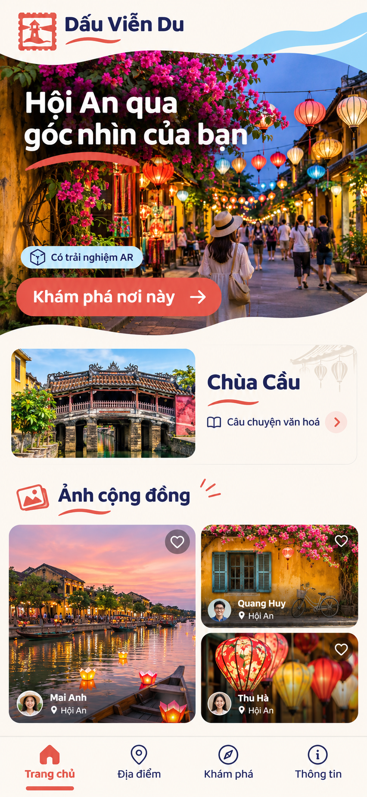
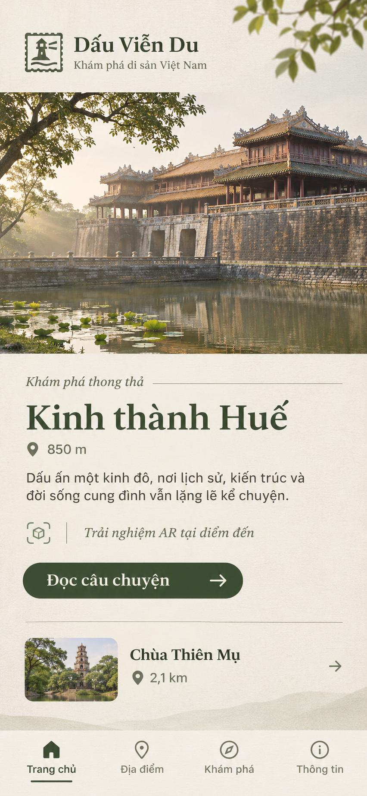
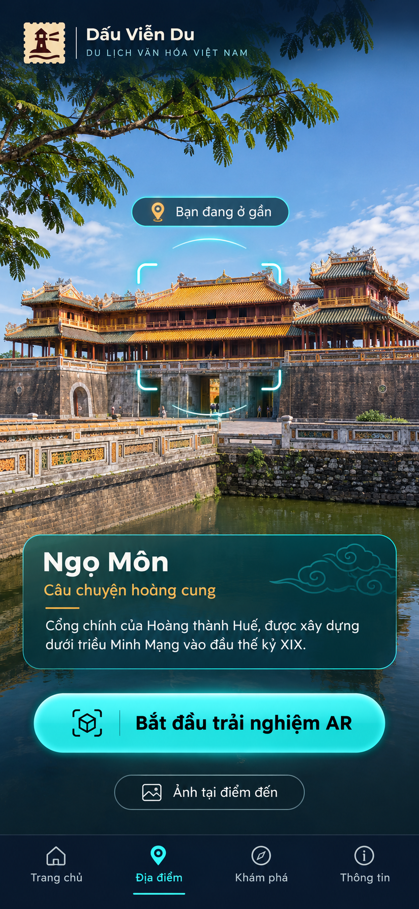

# Dấu Viễn Du — UX/UI design options

## Mục tiêu

Tạo năm hướng giao diện mobile độc lập để người dùng chọn trước khi có bước triển khai. Đây là các concept hình ảnh, chưa phải prototype tương tác hay đặc tả pixel-perfect.

## Brief chung

- Sản phẩm: app di động Dấu Viễn Du, khám phá điểm tham quan văn hóa tại Việt Nam.
- Người dùng: khách du lịch trong nước và quốc tế đang muốn tìm địa điểm gần mình.
- Hành trình cốt lõi: khám phá điểm đến → đọc câu chuyện văn hóa → xem ảnh cộng đồng hoặc mở trải nghiệm AR tại địa điểm.
- Tham chiếu thương hiệu: logo app gốc `branding/playstore-icon-512.png`.
- Mỗi concept là một màn hình mobile độc lập, nội dung tiếng Việt, cùng bốn mục điều hướng: Trang chủ, Địa điểm, Khám phá, Thông tin.

## Thứ tự ảnh

Thứ tự dưới đây khớp với thứ tự năm hình đã xuất hiện trong task UX/UI Design.

### 1. Di sản biên tập

Phong cách tạp chí văn hóa, ảnh di sản lớn, giấy ngà và màu gạch. Trọng tâm là khám phá câu chuyện của địa điểm.

### 2. Bản đồ trung tâm

Bản đồ phố cổ chiếm phần lớn màn hình, bảng địa điểm gần nhất neo ở cạnh dưới. Trọng tâm là tìm và mở một POI quanh mình.

### 3. Nhật ký cộng đồng

Ảnh của du khách dẫn vào địa điểm và câu chuyện văn hóa. Trọng tâm là khám phá qua hình ảnh cộng đồng.

### 4. Du lịch chậm

Bố cục thoáng, màu thiên nhiên và ảnh kiến trúc tĩnh lặng. Trọng tâm là đọc một câu chuyện tại điểm đến mà không bị phân tâm.

### 5. Ống kính AR

Ảnh tại di tích với thẻ câu chuyện không gian, điểm báo vị trí và nút bắt đầu AR. Trọng tâm là trải nghiệm tại chỗ.

## Yêu cầu kiểm tra cho task FT Dev

Rà soát tính rõ ràng của mục tiêu chính, khả năng đọc nội dung tiếng Việt, phân biệt thị giác giữa năm concept, tính phù hợp với luồng khám phá văn hóa hiện có, và khả năng chuyển thành native Android/iOS. Đây là review bộ concept; chưa triển khai giao diện hoặc chạy build cho tới khi người dùng chọn hướng.
